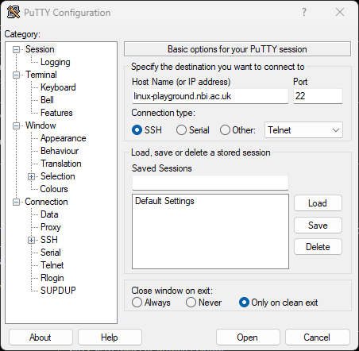

# Training Pills (content)

Source content for JIC Informatics' Training Pills: short, self-contained
training materials, rendered at `informatics.jic.ac.uk/training-pills/` by
the [`flask-training-pills`](https://git.nbi.ac.uk/informatics-web-services/flask-training-pills)
app. This repo holds only the `.md` files, their `images/`, and `categories.yml`; the app
itself lives separately and just reads whatever's here.

## Adding a pill

1. Add a new `.md` file at the root of this repo, one pill per file. Plain
   Markdown, no front-matter required.
2. The filename becomes both the URL and the title, e.g. `git-basics.md` →
   `/training-pills/git-basics`, titled "Git Basics" (hyphens/underscores
   become spaces, title-cased automatically).
3. Add the new filename's slug (no `.md`) under a category in
   `categories.yml`, so it shows up grouped on the index page instead of
   under the catch-all "Other" heading.
4. Push to `main`. The app's sync timer picks up new/changed pills within
   15 minutes (or ask whoever runs it to trigger a sync sooner).

## Images and screenshots

Put a pill's images in `images/<pill-slug>/` and link them relatively:

```markdown

```

The app serves them at `/training-pills/images/...` (PNG, JPEG, GIF, WebP and
SVG only), and the same link works when the `.md` is viewed on GitLab.
Always write the alt text as a description of what the image shows, for
anyone who can't see it. Crop screenshots to the part that matters and keep
them under ~300 KB.

## `categories.yml`

Maps category name → ordered list of pill slugs, purely for how the index
page groups things; it doesn't change any pill's content or URL:

```yaml
Linux & Command Line:
  - linux-basics
  - wsl-basics

HPC & Scientific Computing:
  - slurm-basics
  - conda-basics
```

A pill left out of this file still appears on the index page (just under
an "Other" heading), so forgetting this step never hides content, it just
leaves it uncategorized until someone adds it.
