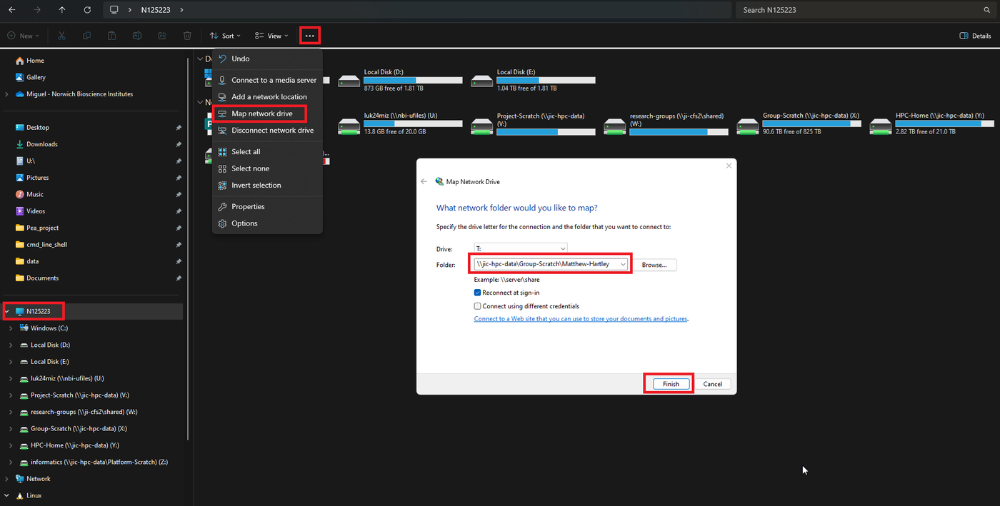
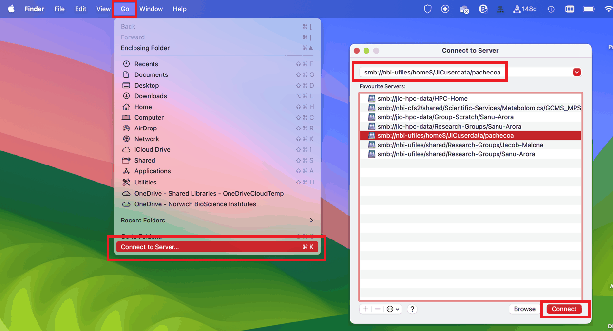
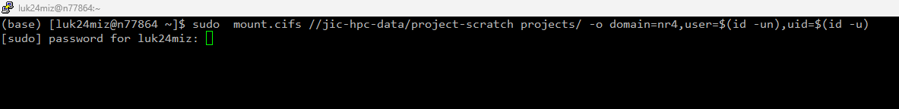

# JIC Network Storage: Where Your Data Lives and How to Reach It

## Mapping and mounting the right location from Windows, macOS, and Linux

**Time:** about 15–20 minutes
**Level:** Beginner — no prior networking or Linux experience needed

By the end of this tutorial, you will be able to:

- Name the main network storage locations at JIC/NBI and what each is actually for
- Know which locations are backed up, and which are not safe for your only copy of something
- Map the HPC storage (Isilon) as a network drive from Windows
- Connect to it from macOS's Finder
- Mount it from a Linux terminal

The main idea to take away:

> **Not every JIC network location is backed up, sized, or suited for research data the same way. For real bioinformatics work — sequencing reads, assemblies, anything more than a few GB — the one you want is NBI's HPC storage (Isilon), not your U drive or OneDrive.**

---

## 1. Where NOT to keep your only copy

Your laptop/desktop, any instrument's attached computer, and external drives (USB sticks, SD cards, portable hard drives) are not backed up by NBI Computing. If that's the only place your data lives, a stolen laptop or a failed drive is a total loss. Use one of the network locations below instead, and treat local/external storage as a working copy at most.

## 2. The storage locations at a glance

| Location | Typical access | Good for | Not good for |
| --- | --- | --- | --- |
| **U drive** | `\\nbi-ufiles\<username>`, auto-mapped | Personal documents, up to 20 GB, backed up with snapshots | Shared data, anything over a few GB |
| **OneDrive / SharePoint** | Via your Microsoft account | Shared drafts, protocols, SOPs, real-time co-authoring | Raw bioinformatics data or large file trees — it breaks metadata, chokes bandwidth, and triggers endless sync conflicts |
| **Computing shared folders** | `\\files`, `\\ji-cfs2`, manual mapping | Team-shared documents | Big data — quota is small and it isn't designed for it |
| **HPC storage (Isilon)** | `\\jic-hpc-data`, manual mapping/mounting | Sequencing data, assemblies, anything a bioinformatics pipeline reads or writes | — this is the one built for it: 40+ PB across the institute |

If you're not sure which to use: documents and protocols go in OneDrive/SharePoint; anything your pipeline touches goes on the HPC storage.

## 3. Accessing HPC storage from Windows

Open File Explorer, click the **"…"** (more) menu, then **Map network drive**:



Pick a free drive letter, and set the folder to the path you were given, e.g.:

```text
\\jic-hpc-data\Group-Scratch\<your-username>
```

Tick **Reconnect at sign-in** so it's there again next time you log in, then **Finish**.

## 4. Accessing HPC storage from macOS

In Finder, open the **Go** menu and choose **Connect to Server…** (`⌘K`):



Enter the same location as an `smb://` URL instead of a Windows-style path:

```text
smb://jic-hpc-data/group-scratch/<your-username>
```

**Connect**, and it mounts under `/Volumes/` and appears in Finder's sidebar.

## 5. Accessing HPC storage from Linux

There's no GUI shortcut here — you need `sudo` rights to run `mount.cifs`:



```bash
mkdir -p projects
sudo mount.cifs //jic-hpc-data/project-scratch projects/ \
  -o domain=nr4,user=$(id -un),uid=$(id -u)
```

`domain=nr4` is NBI's AD domain; `user=$(id -un)` and `uid=$(id -u)` fill in your own username and user ID automatically, so the mounted files show up owned by you rather than root.

> **On linux-playground specifically**, you don't need any of this for your own U drive — the [Linux Playground](linux-playground.md) pill's `mountu` command does it for you.

## 6. Path formats, side by side

The same network location is written differently depending on where you're connecting from:

| OS | Format | Example |
| --- | --- | --- |
| Windows | `\\server\share\path` | `\\jic-hpc-data\Group-Scratch\jdoe` |
| macOS | `smb://server/share/path` | `smb://jic-hpc-data/group-scratch/jdoe` |
| Linux | `//server/share/path` (as a `mount.cifs` argument) | `//jic-hpc-data/group-scratch` |

Same server, same share, same data — just a different separator and prefix per OS.

## 7. Your storage survival kit

| Task | Where |
| --- | --- |
| Personal documents, small, backed up | U drive (`\\nbi-ufiles\<username>`) |
| Shared drafts/protocols, co-authoring | OneDrive / SharePoint |
| Team shared documents | Computing shared folders (`\\files`, `\\ji-cfs2`) |
| Sequencing data, assemblies, pipeline I/O | HPC storage / Isilon (`\\jic-hpc-data`) |
| Map it on Windows | File Explorer → **…** → **Map network drive** |
| Connect on macOS | Finder → **Go** → **Connect to Server…** (`⌘K`), `smb://...` |
| Mount on Linux | `sudo mount.cifs //jic-hpc-data/<share> <local-dir>/ -o domain=nr4,user=$(id -un),uid=$(id -u)` |

## Practice exercise

- [ ] Identify which of the four storage locations your current project's raw data should live on
- [ ] Map or mount the HPC storage from your own machine, following the section for your OS
- [ ] Create a test file in it and confirm you can see it again after reconnecting/remounting
- [ ] Check what's currently sitting only on your local machine or an external drive, and move anything irreplaceable onto a backed-up location

---

Based on JIC Informatics' Data Management training course — see the [Data Management Guide](https://jic-datamanagement.informatics.jic.ac.uk/data-management) and the [full slide deck](https://jic-datamanagement.informatics.jic.ac.uk/data-management/presentation) for the complete session, including backup/recovery, sharing large datasets externally (Dropoff, Globus), and uploading to EBI/SRA.
