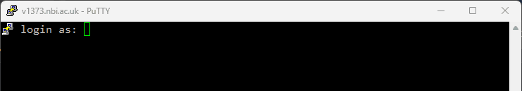
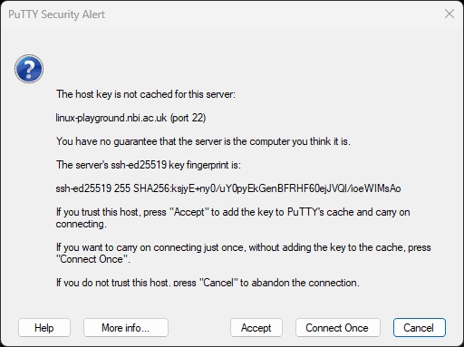
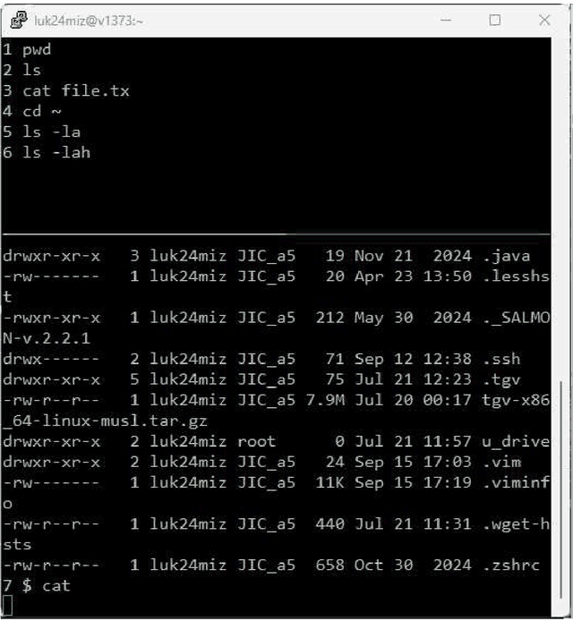

# Linux Playground

## A shared Linux machine for practising and for training labs

**Time:** about 15–20 minutes
**Level:** Beginner — no prior experience needed; pairs well with the [Linux](linux-basics.md) pill

By the end of this tutorial, you will be able to:

- Explain what linux-playground is for, and what it isn't for
- Log in from Windows, Mac or Linux
- Link your U drive, so files you make are visible in Windows
- Know where to keep files, and how much space there is
- Get data onto the machine and results off it
- Find the bioinformatics tools that are already installed
- Follow a trainer's screen during a class
- Ask `biowizard` for help when a command doesn't do what you expected

The main idea to take away:

> **linux-playground is a safe place to learn: a real Linux machine with the common tools already installed, where nothing you do can break anything that matters. For real analyses, use the HPC.**

---

## 1. What it is

linux-playground (`linux-playground.nbi.ac.uk`) is a small Linux server run by JIC Informatics for training. Many pills in this series, and most of our hands-on courses, use it for their exercises.

| | |
| --- | --- |
| System | AlmaLinux 9 |
| CPUs / memory | 8 cores, 15 GB, **shared by everyone logged in** |
| Who can log in | Everyone at the NBI, with your usual username and password |
| Internet | Yes, so `wget` and `curl` work |

**Use it for:** learning commands, working through pills and course labs, testing a small command before you run it on the HPC.

**Don't use it for:** real analyses, large data, or anything confidential. It is small and shared, other people (including trainers) can see what runs on it, and it isn't backed up. For real work, use the HPC (see the [Slurm](slurm-basics.md) and [Open OnDemand](open-ondemand-basics.md) pills).

## 2. Logging in

You need your **NBI username and password**, the same ones you use to log in to your PC. You connect from the institute network; off site, connect to the VPN first.

**Windows: PuTTY.** Open PuTTY, type `linux-playground.nbi.ac.uk` in **Host Name**, leave the port at 22 and the connection type at **SSH**, and click **Open**.


A black terminal window opens and asks for your username at `login as:`. Type it and press Enter, then type your password at the next prompt.



**Windows, Mac, Linux or [WSL](wsl-basics.md): a terminal.** Windows 10 and 11 include `ssh` in PowerShell and Windows Terminal; on a Mac use the Terminal app.

```bash
ssh <your-username>@linux-playground.nbi.ac.uk
```

Two things surprise people the first time:

**A question about the host's "fingerprint"** appears on your first connection only. It's your computer asking whether it can trust this server. Check that the fingerprint ends in `ioeWIMsAo` (the full value is `SHA256:ksjyE+ny0/uY0pyEkGenBFRHF60ejJVQl/ioeWIMsAo`), then click **Accept** in PuTTY, or type `yes` in a terminal.



You'll see it again on a new computer, and that's fine. But if PuTTY ever says the host key **doesn't match** the one it has stored (*"WARNING - POTENTIAL SECURITY BREACH!"*), click **Cancel** and ask JIC Informatics.

**Nothing appears while you type your password.** No dots, no stars. That's normal: type it and press Enter.

You'll then see a welcome banner, ending with a tip about `biowizard` (Section 8), and a prompt like this:

```text
[username@v1373 ~]$
```

`v1373` is the machine's real name. You're in your home folder (`~`) and ready to type commands. To log out, type `exit` or press `Ctrl-d`.

## 3. Link your U drive

Your files on linux-playground are only on linux-playground. To see them in Windows as well, for example to open a result in Excel or IGV, link a folder of your U drive with `mountu`.

1. **Once only, in Windows:** open File Explorer, go to your U drive (`U:`), and create a folder named exactly `informatics`.
2. **On linux-playground**, after each restart of the machine:

   ```bash
   mountu
   ```

   It asks for your password (again, nothing appears as you type).

3. Check it worked: create a text file in `U:\informatics` from Windows, then:

   ```bash
   ls ~/u_drive
   ```

Anything you save in `~/u_drive` is now in `U:\informatics`, and the other way round. If `mountu` says *"The network share is already mounted"*, it's already done.

> **Work in `~/u_drive` during labs.** Your results are then saved on your U drive, and you can open them from Windows straight away, with no copying.

## 4. Where to keep files

| Place | Space | Notes |
| --- | --- | --- |
| `~/u_drive` | Your U drive | **Best place for your work.** Visible from Windows |
| `~` (home) | About 5 GB free, **shared by all users** | Fine for small exercises. Don't fill it up |
| `/tmp` | Under 1 GB, shared | Files are deleted after 10 days |

Check how much space a folder uses with `du -sh <folder>`, and how full a disk is with `df -h ~`.

## 5. Getting data in and out

**From the internet**, including our [Training Repo](https://repo.informatics.jic.ac.uk/), where course data lives:

```bash
wget https://repo.informatics.jic.ac.uk/bioinformatics26/data.zip
unzip data.zip
```

**From or to your PC:** save it in `U:\informatics` and it appears in `~/u_drive` (Section 3). For other folders, copy files with `scp` from your PC's terminal, or use WinSCP on Windows (host `linux-playground.nbi.ac.uk`, the same username and password):

```bash
scp results.txt <your-username>@linux-playground.nbi.ac.uk:~/
```

## 6. Software already installed

Everything below is ready to use. Just type its name; there's nothing to load.

| Tool | Version | Used for |
| --- | --- | --- |
| `bwa` | 0.7.18 | Mapping DNA reads to a reference |
| `bowtie2` | 2.5.4 | Mapping DNA reads |
| `hisat2` | 2.2.1 | Mapping RNA-seq reads |
| `samtools` | 1.18 | SAM/BAM files |
| `bcftools` | 1.21 | VCF files and variant calling |
| `fastqc` | 0.12.1 | Read quality reports |
| `salmon` | 1.10.0 | Transcript quantification |
| `Trinity`, `velveth`/`velvetg` | | Transcriptome and genome assembly |
| `quicktree` | | Phylogenetic trees |
| `python3` | 3.12 | Python scripting |
| `conda` | 25.1 | Installing more software (see the [conda](conda-basics.md) pill) |
| `git`, `nano`, `vim`, `tmux` | | Version control, editing, persistent sessions |

Check where a tool is and which version you're running:

```bash
command -v samtools
samtools --version
```

Not installed: R, Singularity/Apptainer and `screen`. For those, use the HPC.

## 7. Following a class

In a course, the trainer shares their screen through linux-playground. Open **two** PuTTY windows or terminals, and log in on both:

- **Window 1, to watch:** type `atraining`. You'll see the trainer's terminal live, with their last few commands at the top. You can't type in it. To leave, press `Ctrl-b`, then `d`.
- **Window 2, to work:** type the commands yourself here.



The top part lists the trainer's last few commands, numbered, so you can catch up if you look away. The bottom part is their live terminal.

If `atraining` says `error connecting to /var/lib/training/socket` or `no server running`, the trainer hasn't started the session yet. Try again in a minute.

When the trainer highlights text with the mouse, you'll see it highlighted too: that's them pointing at something.

> **For trainers:**
>
> - `ctraining` starts the shared screen (members of `informatics` or `CiS`), or joins it if it's already running. `kill-training` stops it at the end.
> - **Assistant trainers** join with `wtraining` and can type too. It only works for trainers: members of `informatics` or `CiS`, or anyone added to the trainers list (ask JIC Informatics).
> - **Point with the mouse:** drag over text to highlight it for everyone; the highlight stays for 3 seconds after you let go, then clears by itself (wait for it before typing). The wheel scrolls back through output; scroll back down, or press `q`, to type again. To copy text in PuTTY, hold Shift while dragging.
> - Anything typed in the shared screen runs as the trainer who started it, so don't use `sudo` or open anything private there.
>
> Setup details: [linux-playground repo](https://git.nbi.ac.uk/Miguel-projects/linux-playground).

## 8. Getting help: biowizard

Stuck on an error, or not sure what to type next? Ask `biowizard`, a model hosted at the NBI that knows this machine and its tools. Type your question straight after it, in plain English:

```bash
biowizard why did my last command fail?
biowizard how do I count the reads in a fastq.gz file?
```

```text
$ bwa mem ref.fa reads_R1.fastq.gz > out.sam
[E::bwa_idx_load_from_disk] fail to locate the index files
$ biowizard why did that fail?
biowizard is thinking...
BWA can't find the index for ref.fa: it has to be built once before mapping.
  bwa index ref.fa
Then run your bwa mem command again.
```

*(An example: answers vary.)*

**What it looks at.** To fit its answer to what you're doing, `biowizard` sends the model your **last 20 commands**, whether the last one **failed**, the **folder you're in** and the **names of the files** there. To see an **error message**, it needs one of these:

**Paste it.** If your last command failed, `biowizard` asks you to paste the error: select it with the mouse in PuTTY (that copies it), right-click to paste, press Enter, then `Ctrl-d`. Use `biowizard -p <question>` to paste any time.

**Pipe it in.** Run the command again and send its output to `biowizard`:

```bash
bwa mem ref.fa reads_R1.fastq.gz 2>&1 | tail -20 | biowizard what does this error mean?
```

`2>&1` includes the error messages, and `tail -20` keeps just the end, where errors usually are.

**Let it see your screen.** Run `biowizard on` once. From then on, what appears in your terminal is copied to a private file (only you can read it, it's deleted when you log out), and `biowizard` reads the last 40 lines when you ask. Your window restarts, in the same folder, with recording on (anything you'd set with `export` is cleared). It stays on for future logins until you run `biowizard off`; `biowizard status` tells you whether it's on, and the login banner shows it in red when it's on. Scrolling back in PuTTY works as usual.

Good to know:

- **It suggests commands; it never runs them.** Read what it suggests before you type it, especially anything with `rm`, `mv` or `>`, which delete or overwrite files.
- **It can be wrong.** Treat its answer as a hint, and ask the trainer if it doesn't make sense or doesn't work.
- **Up to 30 questions an hour** each. The first question after a quiet spell can take up to half a minute while the model loads; after that, answers take a few seconds.
- **Your questions are kept**, with the context sent (including the screen lines, if you turned that on), so trainers can see where people get stuck. Don't ask about, paste or pipe in anything confidential.
- **Questions or problems with `biowizard` itself?** Email informatics@nbi.ac.uk.
- Quote or avoid `?`, `*` and `!` if your question gets mangled: the shell treats them specially. `biowizard 'why?'` is always safe.

## 9. Being a good neighbour

- **Keep it small.** Everyone shares 8 CPUs and 15 GB of memory. Exercises are sized for this; real data isn't.
- **Don't leave things running.** Check with `top` (press `q` to quit), and stop your own runaway command with `Ctrl-c`.
- **Clean up** large files you no longer need, especially in your home folder and `/tmp`.
- **Nothing confidential.** It's a shared training machine.

## 10. When something goes wrong

| What you see | What it means |
| --- | --- |
| `Permission denied, please try again.` at login | Wrong username or password. Use your NBI username, not your email address |
| `Connection timed out` | You're off site without the VPN, or the address is mistyped |
| `mount error(2): No such file or directory` from `mountu` | There's no `informatics` folder in your U drive yet (Section 3, step 1) |
| `mount error(13): Permission denied` from `mountu` | Wrong password; run `mountu` again |
| `ls ~/u_drive` is empty but `U:\informatics` isn't | The link was lost when the machine restarted; run `mountu` again |
| `command not found` | Check the spelling. If the tool isn't in Section 6, it isn't installed |
| `biowizard: couldn't reach the model` | The model server is down or busy; ask the trainer instead |
| `biowizard` asks you to paste, though you ran `biowizard on` | This window was opened before recording was turned on; log out and back in |
| `No space left on device` | Your home folder or `/tmp` is full; delete what you don't need, or work in `~/u_drive` |

## 11. Your linux-playground survival kit

| Command | What it does |
| --- | --- |
| `ssh <user>@linux-playground.nbi.ac.uk` | Log in |
| `exit` | Log out |
| `mountu` | Link `U:\informatics` to `~/u_drive` |
| `cd ~/u_drive` | Go to your U drive folder |
| `wget <url>` | Download a file |
| `scp <file> <user>@linux-playground.nbi.ac.uk:~/` | Copy a file from your PC |
| `du -sh <folder>` / `df -h ~` | How much space a folder uses / how full the disk is |
| `command -v <tool>` | Is this tool installed, and where |
| `atraining` | Watch the trainer's screen (`Ctrl-b` then `d` to leave) |
| `biowizard <question>` | Ask for help; pipe a command's output in with `2>&1 \| biowizard ...` |
| `biowizard on` / `off` / `status` | Let `biowizard` see your screen, or stop it |
| `top` | See what's running (`q` to quit) |

## Practice exercise

Work through the following steps yourself to make sure everything sticks:

- [ ] Log in to linux-playground, accept the fingerprint, and find `v1373` in your prompt
- [ ] Create `U:\informatics` in Windows, run `mountu`, and see a file you made in Windows with `ls ~/u_drive`
- [ ] Create a file in `~/u_drive` from linux-playground, and open it in Windows
- [ ] Check how much free space there is with `df -h ~`
- [ ] Download a file from the [Training Repo](https://repo.informatics.jic.ac.uk/) with `wget`
- [ ] Find `bwa` and `samtools` with `command -v`, and print their versions
- [ ] Run a command that fails (try `bwa mem nofile.fa`), then ask `biowizard why did that fail?`
- [ ] Log in from a second window, and log out of both with `exit`
- [ ] Now try the [Linux](linux-basics.md) pill's exercises here
