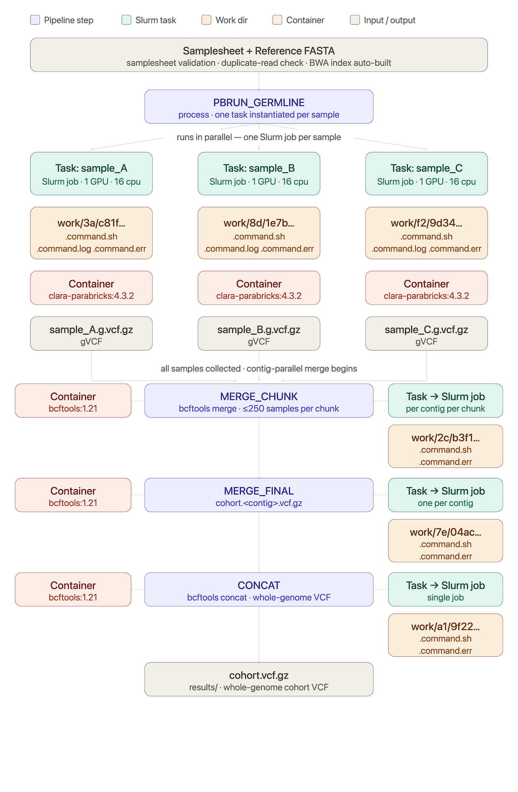

# GPU Variant Calling with Parabricks and Nextflow

## From FASTQ files to a cohort VCF with parabricks-germline-nf

**Time:** about 45–60 minutes (plus queue time for the GPU test)
**Level:** Intermediate — assumes you have done the [Slurm](slurm-basics.md), [git](git-basics.md), [conda](conda-basics.md) and [Singularity](singularity-basics.md) pills

By the end of this tutorial, you will be able to:

- Describe the biology behind it: reads, alignment, variants and genotypes
- Explain what the pipeline does, from FASTQ files to a multi-sample VCF
- Explain the few Nextflow ideas you need: processes, the work directory, profiles and `-resume`
- Set up Nextflow in a conda environment and use the shared install of the pipeline
- Get the container images, either pre-built or built from the recipes in the repo
- Write a samplesheet for your own samples
- Check your setup with a dry run, then with a small real GPU test
- Launch a full run on the cluster, follow its progress and resume it after a failure
- Find your results and know what the merged VCF does and does not contain

The main idea to take away:

> **You describe *what* to run (samplesheet, reference, profile) and Nextflow works out *how*: it submits every step as a Slurm job, runs it in a fixed container, and remembers what already finished so a failed run picks up where it stopped.**

---

## 1. The biology in brief

Every individual (a plant, an animal, a person) carries small differences in its DNA compared with a **reference genome**, the agreed "standard" sequence for that species. Most differences are **SNPs** (single-letter changes, e.g. `A` → `G`) or short **indels** (a few letters inserted or deleted). **Germline** variants are the ones the individual inherited and carries in every cell, as opposed to mutations that arise in one tissue, such as in a tumour.

Finding these differences across many individuals is the starting point for most population and breeding genetics: measuring diversity, building trees of relatedness, linking variants to traits (GWAS, QTL mapping) and designing markers.

The pipeline does this in three biological steps:

1. **Alignment: where does each read come from?** The sequencer produces millions of short reads (typically 2 × 150 bp) from random positions in the genome. Each read is placed at its best-matching position in the reference. Reads that are just PCR copies of the same DNA fragment are flagged as **duplicates**, so they aren't counted twice as evidence.
2. **Variant calling: where does this sample differ?** At each position, the caller (GATK HaplotypeCaller) looks at all the reads stacked on top of it. If they consistently show a different letter from the reference, that's a variant. It then decides the **genotype**:

   ```text
   Reference   ...ACGTTAGC...
   Reads       ...ACGTTAGC...   0/0  same as reference on both copies (homozygous reference)
               ...ACGCTAGC...
               ...ACGTTAGC...   0/1  one copy of each (heterozygous)
               ...ACGCTAGC...
               ...ACGCTAGC...   1/1  different on both copies (homozygous alternative)
   ```

   Inbred lines, such as most wheat landraces, are mostly `0/0` or `1/1`.
3. **Merging: one table for the whole cohort.** The per-sample results are combined into one **VCF** (Variant Call Format) file. It is essentially a table with one row per variant position and one column per sample, holding that sample's genotype. This matrix is what downstream analyses use.

**More reads per position (coverage) means more confident genotypes.** At 2× coverage a heterozygous site can easily look homozygous by chance; at 10–30× it rarely does.

> **Wheat note:** bread wheat is hexaploid, with three closely related sub-genomes (A, B and D). A read from one sub-genome can align to the matching gene on another, which can create false variants. Filtering the final VCF on quality, depth and missing data is therefore essential, and is not done by this pipeline.

## 2. What the pipeline does

`parabricks-germline-nf` takes paired-end FASTQ files for many samples and produces per-sample and cohort VCFs. The slow part, alignment and variant calling, runs on GPUs with NVIDIA Parabricks, which is many times faster than CPU-only BWA + GATK.

```text
FASTQ (1+ lanes per sample)
  └─ pbrun germline (BWA-MEM + sort + markdup + HaplotypeCaller, GPU)  -> cram/<sample>.cram
       └─ bgzip + index                                                -> vcf/<sample>.g.vcf.gz
            └─ bcftools merge --gvcf, per contig, in sample chunks     -> merged/per_contig/<prefix>.<contig>.vcf.gz
                 └─ bcftools concat (reference order)                  -> merged/<prefix>.vcf.gz
```

Each sample's calls are written as a **gVCF**: besides the variants, it records the stretches where the sample matched the reference and how many reads covered them. When the gVCFs are merged, that lets every sample get a real genotype at every variant site, `0/0` where it was covered and matches the reference, instead of "missing" (Section 11 explains why this matters).

Repository: `https://git.nbi.ac.uk/workflows/parabricks-germline-nf`

## 3. Just enough Nextflow

- **Process**: one step of the pipeline (e.g. `PBRUN_GERMLINE`, `MERGE_CHUNK`). Each sample, or each contig, becomes its own **task**, and on the cluster each task is its own Slurm job.
- **Work directory**: every task runs in its own folder under `work/` (e.g. `work/8d/1e7b43...`). It holds the task's script (`.command.sh`), its log (`.command.log`) and its errors (`.command.err`). This is where you look when something fails.
- **Container**: every process runs inside a fixed image (Parabricks 4.3.2, bcftools 1.21, ...), so everyone gets the same tool versions.
- **Profile**: a named bundle of settings chosen with `-profile`. `jic` sets the right partitions, GPUs, local SSD and containers for our cluster; `test` uses a tiny bundled dataset.
- **`-resume`**: reuse every task that already finished successfully. You almost always want it.

> **Note:** Nextflow options have **one dash** (`-profile`, `-resume`); pipeline options have **two** (`--samplesheet`, `--ref`).



## 4. One-time setup

> **Internet access:** `software23` is the only node with internet access. Anything that downloads (creating the conda environment, building containers) has to be done there: `ssh software23`. Running the pipeline happens everywhere else, offline.

**Nextflow in a conda environment.** If you haven't used conda on the HPC yet, do the [conda](conda-basics.md) pill first: it covers the `~/.condarc` channel setup that JIC requires (Anaconda's own channels are blocked). Then, on `software23`:

```bash
ssh software23
conda create -n nf-env nextflow
conda activate nf-env
nextflow -version
exit
```

**The pipeline is already installed.** A shared copy lives in `/jic/common/workflows/parabricks-germline-nf`, so there's nothing to clone. You run it from **your own project folder**, in scratch where there is space; `work/` and `results/` are written there, never in the shared copy. Save the path in a variable to keep commands short:

```bash
PIPE=/jic/common/workflows/parabricks-germline-nf
mkdir -p /jic/scratch/groups/<your-group>/<you>/my-project
cd /jic/scratch/groups/<your-group>/<you>/my-project
```

Add the `PIPE=...` line to your `~/.bashrc` so it's always set.

**Work offline**

Apart from `software23`, nodes have no internet access. Without the line below, Nextflow can sit for minutes trying to download things before giving up:

```bash
export NXF_OFFLINE=true
```

The launcher script (Section 8) sets this for you; you only need it when running `nextflow` by hand.

## 5. Containers

Every step runs inside a Singularity container, so you don't install BWA, Parabricks or bcftools yourself. The [Singularity](singularity-basics.md) pill explains how containers work. The images are too big for git (Parabricks alone is several GB), so the repo holds small **definition files** (`containers/*.def`) instead.

- **Using the shared install:** the images are already built, in `$PIPE/containers/sif/`, and the `jic` profile uses them. There's nothing to do.
- **Building your own** (e.g. for your own clone of the repo): building needs internet and root rights, both available on `software23`:

```bash
ssh software23
cd /path/to/your/parabricks-germline-nf
containers/build.sh                # builds into containers/sif/
exit
```

This builds the four images from the `.def` files (Parabricks is the slow one) and tests each one. If you put them somewhere else, add `--container_dir /that/folder` to your runs. The pipeline uses these local files and never needs internet.

## 6. Your samplesheet

A CSV with **one row per FASTQ pair**. Rows that share a `sample_id`, such as several lanes of one sample, are combined into one Parabricks run.

```csv
sample_id,read1,read2
S1,/path/S1_L001_R1.fastq.gz,/path/S1_L001_R2.fastq.gz
S1,/path/S1_L002_R1.fastq.gz,/path/S1_L002_R2.fastq.gz
S2,/path/S2_R1.fastq.gz,/path/S2_R2.fastq.gz
```

- `sample_id` becomes the sample name in the VCF. Use only letters, digits, `.`, `_` and `-`.
- Paths can be absolute, or relative to the samplesheet's folder.
- You don't need to say how many GPUs a sample needs: the pipeline works it out from the sample's FASTQ size (Section 8). An optional `gpus` column overrides that for a sample.

> **One `sample_id` per biological sample.** Every row (lane, flowcell, sequencing run) of a sample must carry the same `sample_id`. Rows with different IDs are called as different samples and become separate VCF columns, and their genotypes can't be combined afterwards: the only fix is to call the variants again. Don't add lane numbers to the ID (`cezanne_L2`, `cezanne_L3`); that is exactly how a 292-variety run once ended up with 535 VCF columns.

**The samplesheet is checked before anything runs.** The run stops with a list of problems if:

- a FASTQ file is missing,
- the same FASTQ file is on two rows,
- sample IDs differ only by a lane suffix (`x_L1`, `x_L2`); add `--allow_lane_ids` only if they really are different samples,
- two files contain the same sequencing data, e.g. a raw file and its trimmed copy (same run, lane and index in the read headers).

It also prints how FASTQ pairs were grouped, for example `Samplesheet: 762 FASTQ pairs -> 291 samples`. **Check that the sample count is what you expect** before the GPU jobs get far.

## 7. Test before you scale up

**Step 1: dry run (seconds, no GPU).** `-stub` replaces every tool with a command that just creates empty files, so this checks the wiring and the config:

```bash
interactive
conda activate nf-env
export NXF_OFFLINE=true
cd /jic/scratch/groups/<your-group>/<you>/my-project
nextflow run $PIPE -profile test,stub -stub
```

Every process should finish with a ✔.

**Step 2: real GPU test on tiny data (a few minutes plus queue time)**

```bash
cd /jic/scratch/groups/<your-group>/<you>/my-project
NF_CONDA_ENV=nf-env sbatch $PIPE/scripts/submit_slurm.sh -profile jic,test \
    --jic_gpu_scratch_gb 50 --min_scratch_gb 0 \
    --max_cpus 8 --max_memory '64 GB' --gpu_ladder '1:8:64'
```

> **Why the extra options?** The test data is tiny, so these shrink the requests: one small rung (1 GPU, 8 CPUs, 64 GB) and 50 GB of local SSD. Without them the job would ask for 16 CPUs, 240 GB and 850 GB of SSD, and wait longer in the queue.

When it finishes, check the merged VCF. `bcftools` isn't available on the command line by default. The simplest option is the pipeline's own bcftools container, the same version that wrote the file:

```bash
BCFTOOLS="singularity exec $PIPE/containers/sif/bcftools-1.21.sif bcftools"
$BCFTOOLS query -l results_test/merged/test.vcf.gz          # S1, S2, S3
$BCFTOOLS view -H results_test/merged/test.vcf.gz | wc -l   # 34 variant sites
$BCFTOOLS query -f '[%GT\n]' results_test/merged/test.vcf.gz | sort | uniq -c
```

The last command should show only `0/0` (38) and `1/1` (64), and no `./.`: every sample is well covered in the test data, so every sample has a real genotype at every site.

Or load it as a module or a Software Catalogue package; the [HPC Software](hpc-software-basics.md) pill explains both:

```bash
ml av bcftools                  # list the module versions, then e.g. ml bcftools/<version>
catalogue --search bcftools     # or find it in the catalogue, then: source package <ID>
```

## 8. A real run

```bash
cd /jic/scratch/groups/<your-group>/<you>/my-project
NF_CONDA_ENV=nf-env sbatch $PIPE/scripts/submit_slurm.sh -profile jic \
    --samplesheet /path/to/samplesheet.csv \
    --ref /path/to/genome.fa \
    --prefix my_cohort \
    --outdir results
```

`submit_slurm.sh` runs Nextflow itself as a small, long-running Slurm job, the **head job**, in the folder you submit from. It activates your conda environment, sets the offline variables and always adds `-resume`. The head job then submits every real task as its own Slurm job.

Useful options:

| Option | Use it when |
| --- | --- |
| `--contigs 1A,1B,...` | You only want some contigs in the merged VCF (e.g. skip unplaced scaffolds) |
| `--min_contig_length 1000000` | Your genome has thousands of tiny scaffolds |
| `--skip_concat` | You only need per-chromosome VCFs |
| `--run_flagstat` | You want mapping statistics for every CRAM |
| `--pbrun_args '--low-memory'` | Your GPUs have less than 40 GB of memory (not needed on our A100s) |

**GPUs, CPUs and memory are sized for you.** Our GPU nodes each have 32 CPUs and about 1000 GB of RAM, with 1, 2 or 4 A100 GPUs (26 GPUs in `jic-gpu`). The `jic` profile has a **ladder** of three sizes. Parabricks on these nodes is limited by CPUs rather than GPUs (a 93 GB wheat sample took 11.5 hours on 8 CPUs and about 5.7 on 16), so each job gets at least 16 CPUs:

| Rung | GPUs | CPUs | Memory | Starts here when the sample's FASTQ is |
| --- | --- | --- | --- | --- |
| 1 | 1 | 16 | 240 GB | below 300 GB |
| 2 | 2 | 32 | 480 GB | 300 to 600 GB |
| 3 | 4 | 32 | 960 GB | 600 GB and more |

- **Moving up.** If Slurm kills a job for running out of time or memory, the pipeline retries it on the next rung. You don't have to do anything. (Parabricks reports a memory kill as a general error, exit 255, so the pipeline checks the job's memory accounting to tell the two apart. The container needs to see that accounting: the `jic`, `singularity` and `apptainer` profiles give it access, so if you write your own profile, copy their `containerOptions` for Parabricks. Without it, a memory kill sets the sample aside instead of moving it up.)
- **Keeping going.** If a sample still fails on the top rung, or fails for another reason (a corrupt FASTQ, say), it is set aside and the run finishes the others. The log names it and `results/pipeline_info/failed_samples.txt` lists it; fix the cause and resubmit the same command to add it. Use `--stop_on_failure` if you'd rather the run stopped.

The log shows the starting sizes before anything runs:

```text
Starting resources (from FASTQ size, --gpu_start_gb 300,600): 1 GPU/16 CPUs/240 GB: 266, 2 GPUs/32 CPUs/480 GB: 24, 4 GPUs/32 CPUs/960 GB: 1
  altria: 680 GB FASTQ -> 4 GPUs/32 CPUs/960 GB
```

For a very different collection (another genome size or coverage), the thresholds (`--gpu_start_gb 300,600`) and sizes (`--gpu_ladder '1:16:240,2:32:480,4:32:960'`, as GPUs:CPUs:GB) can be changed. `results/pipeline_info/trace_*.txt` shows, for every job, the sample, its FASTQ size, which attempt (rung) it was, and the CPUs, memory and time it actually used; it's the place to look before changing anything.

> **Reference index:** if the BWA index (`.amb .ann .bwt .pac .sa`) and `.fai` sit next to the FASTA, they are used as-is. Otherwise they are built and published to `results/reference/`. For a large genome that takes hours, so copy those files next to the FASTA for next time.

## 9. Watching a run

```bash
squeue -u $USER                     # the head job + the task jobs it submitted
tail -f nextflow_<jobid>.out        # the progress table
```

The log starts with the pipeline version and the folder the run writes to:

```text
Pipeline: /jic/common/workflows/parabricks-germline-nf (v1.2.0)
Run dir : /jic/scratch/groups/<your-group>/<you>/my-project
...
Samplesheet: 762 FASTQ pairs -> 291 samples (291 with more than one pair)
Starting resources (...): 1 GPU/16 CPUs/240 GB: 266, 2 GPUs/32 CPUs/480 GB: 24, 4 GPUs/32 CPUs/960 GB: 1
```

```text
[8d/1e7b43] BWA_INDEX (reference.fa)       | 1 of 1 ✔
[d4/376aa8] PBRUN_GERMLINE (S3 (0 GB))     | 3 of 3 ✔
[be/370374] BCF…ERGE_CHUNK (chrB:chunk2/2) | 4 of 4 ✔
```

The code in brackets (`d4/376aa8`) is the start of that task's work directory: `work/d4/376aa8...`.

After the run, `results/pipeline_info/` has an HTML **report** (CPU, memory and time used by every task) and a **timeline**. Use them to size the next run, just as you would use `seff` for a single Slurm job.

## 10. When something fails

Nextflow prints the failed task's command, its exit status and its work directory. Look there first:

```bash
cd work/d4/376aa8*      # use the code from the error message
cat .command.err        # what the tool complained about
cat .command.sh         # exactly what was run
```

Fix the cause, then resubmit **the same command**. Thanks to `-resume`, only the failed task and those after it run again; hours of finished GPU work are kept.

**Common causes:**

- **`Process requirement exceeds available memory`** when running by hand in a small `interactive` session: the local executor won't start a task that asks for more than the session has. Use the `stub` profile for dry runs, and `sbatch` with `-profile jic` for real ones.
- **`OUT_OF_MEMORY` or `TIMEOUT`** on the cluster: Parabricks jobs move up the ladder automatically (Section 8), and other tasks are retried up to 2 times. A Parabricks sample that fails even on the top rung is listed in `results/pipeline_info/failed_samples.txt` while the rest of the run carries on; for other tasks, raise the matching option (`--merge_memory`, `--merge_time`, ...) and resume.
- **Nextflow hangs at start-up:** `NXF_OFFLINE` isn't set (Section 4).
- **A FASTQ path wasn't found:** a typo in the samplesheet. Fix it and run again.
- **`Samplesheet check failed`:** the run lists the problems grouped by type (same file twice, lane-like sample IDs, same data in two files; see Section 6). Fix the samplesheet; nothing has been submitted yet.

> **Don't delete `work/` while a project is in progress.** That's where `-resume` finds finished tasks. Once the results are safely in `results/` and you're done, delete `work/` to free scratch space; it can be huge.

> **Don't change the pipeline, the samplesheet or the options in the middle of a project.** `-resume` only reuses a finished task if everything that went into it is unchanged, and that includes the pipeline's own code: after updating the shared install (a new version, even a small fix), every sample is processed again. In the first Watkins run, restarts after changes meant about 450 samples were processed twice: roughly 2000 of the 5100 GPU-hours spent. Settle the samplesheet and options with the dry run and the tiny test, note the pipeline version from the first line of the log, and finish the project on that version.

## 11. What you get, and one important caveat

```text
results/
├── cram/                   <sample>.cram (+ .crai), needs the reference FASTA to read
├── vcf/                    <sample>.g.vcf.gz (+ .csi), per-sample gVCFs
├── merged/per_contig/      <prefix>.<contig>.vcf.gz
├── merged/<prefix>.vcf.gz  all contigs, in reference order
├── qc/flagstat/            mapping statistics (with --run_flagstat)
├── reference/              BWA index + .fai, if they had to be built
└── pipeline_info/          report, timeline, trace
```

Sample columns in every merged VCF are sorted by `sample_id`.

**What `0/0` and `./.` mean.** In the merged VCF, `0/0` means "covered and matches the reference" and `./.` means "no reads here" (or fewer than `--gvcf_min_ref_dp`, default 1). That makes missing-data filters and allele frequencies meaningful.

Without gVCFs it is different. A plain per-sample VCF lists only the sample's variants, so after merging, every sample without a call at a site gets `./.`, whether it had 20 reads matching the reference or none at all. In a diversity panel most variants are rare, so most genotypes end up `./.`, and allele frequencies count only the few samples that carry the variant (a variant in 3 of 291 samples looks fixed, AF = 1). If you ever get a VCF made that way (`--gvcf false`, or an older run), treat `./.` with great care.

> **The merged VCF is not joint-genotyped.** Each sample's genotype is still decided from its own reads; the merge only fills in the reference calls. Full GATK joint genotyping (`GenomicsDBImport` + `GenotypeGVCFs`) also re-evaluates every site across all samples. The gVCFs in `vcf/` are exactly its input, so it can be run later without the GPU step.

## 12. A few habits worth building

- **Always run the dry run and the tiny GPU test first** on a new setup, before launching hundreds of samples.
- **Read the `Samplesheet:` and `Starting resources` lines** at the start of every run: check the number of samples, and that the sizes look sensible.
- **Check `results/pipeline_info/failed_samples.txt`** at the end of every run. If it exists, some samples are not in the merged VCF.
- **Always use `-resume`.** The launcher adds it for you.
- **Keep the samplesheet and the exact command with your results**, so the analysis can be repeated.
- **Note the pipeline version** in your methods. The first line of `nextflow_<jobid>.out` shows it, e.g. `Pipeline: /jic/common/workflows/parabricks-germline-nf (v1.2.0)`.
- **Clean up `work/`** once a project is finished.

## 13. Your Parabricks pipeline survival kit

| Command | What it does |
| --- | --- |
| `ssh software23` | The only node with internet: for conda installs and container builds |
| `conda activate nf-env` | Make `nextflow` available |
| `export NXF_OFFLINE=true` | Stop Nextflow trying to reach the internet |
| `PIPE=/jic/common/workflows/parabricks-germline-nf` | Path of the shared install |
| `nextflow run $PIPE -profile test,stub -stub` | Dry run: check the setup in seconds |
| `NF_CONDA_ENV=nf-env sbatch $PIPE/scripts/submit_slurm.sh -profile jic ...` | Launch a run (from your project folder) |
| `tail -f nextflow_<jobid>.out` | Follow progress |
| `snoderes` | Free CPUs and memory on every node, e.g. whether a GPU node has room |
| `cat work/<xx>/<hash>*/.command.err` | See why a task failed |
| `containers/build.sh [dir]` | Build the container images yourself (on `software23`) |
| `singularity exec $PIPE/containers/sif/bcftools-1.21.sif bcftools query -l <vcf>` | List the samples in a VCF, using the pipeline's bcftools container |

## Practice exercise

Work through the following steps yourself to make sure everything sticks:

- [ ] On `software23`, create the `nf-env` conda environment and check `nextflow -version`
- [ ] Create a project folder in your scratch space and set `PIPE` in your `~/.bashrc`
- [ ] Run the dry run (`-profile test,stub -stub`) in an `interactive` session and get all ✔
- [ ] Submit the tiny GPU test with `$PIPE/scripts/submit_slurm.sh` and follow it with `tail -f`
- [ ] List the samples and count the variants in `results_test/merged/test.vcf.gz`
- [ ] Open `results_test/pipeline_info/report_*.html` and find which task used the most memory
- [ ] Find the work directory of one `PBRUN_GERMLINE` task and read its `.command.sh`
- [ ] Write a samplesheet for 2–3 of your own samples, one of them with two lanes
- [ ] Cancel a run halfway (`scancel` the head job), resubmit the same command, and confirm finished tasks show as `cached`
