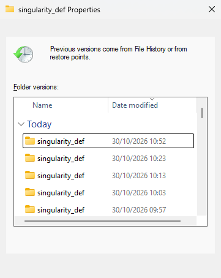
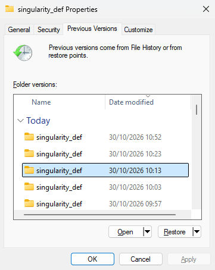

# Recovering Deleted or Changed Files from Snapshots

## You didn't lose it — you just need to find the right snapshot

**Time:** about 10 minutes
**Level:** Beginner — no prior experience needed

By the end of this tutorial, you will be able to:

- Explain what a snapshot is and why it isn't the same thing as a backup
- Know why acting quickly matters when you've deleted or overwritten something
- Use Windows Explorer's Previous Versions to restore an earlier version of a file or folder
- Browse a share's snapshot history directly when Previous Versions isn't an option
- Recognise when a snapshot won't help, and what to do instead

The main idea to take away:

> **Before you panic about a deleted or overwritten file, check whether it lives on HPC storage, Computing's shared folders, or OneDrive — all three keep automatic snapshots, and the fix is usually just browsing back to an earlier point in time, not restoring from an offsite backup.**

---

## 1. What a snapshot actually is

HPC storage (Isilon) automatically takes periodic snapshots: point-in-time copies of a share's contents. Computing's shared folders and OneDrive have their own, similar retention policies. A snapshot isn't a separate backup copy stored somewhere else — it's a space-efficient record kept alongside the live data on the same system, which is why it won't help if the whole storage system itself fails. For that level of disaster recovery, ask Informatics or Computing what the actual offsite backup arrangements are for your data.

Two things worth knowing up front:

- **Retention varies by folder.** How many snapshots are kept, and for how long, depends on the specific share's policy — there's no single institute-wide answer.
- **Time matters.** The more time has passed since you deleted or changed the file, the lower the chance an old enough snapshot still exists. If you've just made the mistake, stop and go look before doing anything else.

## 2. Recovering on Windows: Previous Versions

The easiest way in, when it's available: right-click the folder (or its parent, if the whole folder is gone) on a mapped network drive, choose **Properties**, and open the **Previous Versions** tab. Give it a few seconds to query the server — it lists every snapshot that contains that folder:



Select an older entry from before your mistake. **Open** lets you look inside it first (read-only) to check it's the version you want; **Restore** copies that entire snapshot back over the live folder in place:



> **Restore replaces the whole folder with that snapshot's contents.** If you only need one file back, use **Open** instead, browse into the snapshot, and copy out just that file — safer than overwriting everything in the live folder.

> **Not every network path responds the same way.** This works well for actively-used shares, but on some HPC storage paths the dialog can sit on "Working on it…" for a long time or come back empty even when snapshots do exist. If that happens, don't wait forever — the `.snapshot` method below works everywhere and doesn't depend on this Explorer feature.

## 3. Recovering on macOS or Linux: the `.snapshot` directory

Isilon (and most enterprise storage using the same underlying tech) also exposes snapshots as a hidden directory at the root of the share, conventionally named `.snapshot`. It won't show up in a normal directory listing, but it's there if you navigate to it directly — this works the same way regardless of OS, since it's a property of the share itself, not of Windows' Previous Versions feature specifically:

```text
\\jic-hpc-data\<share>\.snapshot\
```

Inside, you'll find a set of timestamped folders, one per snapshot. Each one is a complete, read-only copy of that share's directory tree as it looked at that point in time. To recover a file:

1. Navigate to the folder that used to contain your file, as normal
2. Go into `.snapshot` from that same location
3. Pick the most recent timestamped folder that's old enough to predate your mistake — if it's not there yet, try an older one
4. Copy the file (or folder) out of the snapshot and back into the live directory, or to a new location if you want to compare both versions first

Permissions inside a snapshot are identical to the permissions on the live data — if you could read or write the original, you can read or write the snapshot copy the same way.

> **Don't edit inside the snapshot.** Snapshots are read-only by design. Copy what you need out, then make your changes in the live directory. If you can't find `.snapshot` for your specific share, ask Informatics or the Computing helpdesk — it's a two-minute question for them and saves you guessing.

## 4. When a snapshot won't save you

- The file lived only on your laptop, an external drive, or somewhere else that was never on backed-up institute storage — see the [JIC Network Storage](jic-network-storage.md) pill for what's actually covered
- Too much time has passed and the relevant snapshot has already rolled off
- The data was never written to a snapshotted location in the first place (e.g. a scratch area with no retention policy)

In any of these cases, the honest answer is that the data may simply be gone — which is the real argument for not treating local-only storage as anything more than a working copy.

## 5. Your recovery survival kit

| Task | How |
| --- | --- |
| Recover on Windows | Right-click the folder → Properties → **Previous Versions** → select a version → Open or Restore |
| Recover on macOS/Linux, or if Previous Versions won't load | Navigate to `<path-to-folder>\.snapshot\` and look for a timestamp before your mistake |
| Recover it (via `.snapshot`) | Copy out of the snapshot folder into the live directory |
| Not sure of the path or whether snapshots apply to your share | Ask Informatics or the Computing helpdesk |
| Prevent needing this in future | Keep raw data read-only and work on copies — see the storage pill's bad-practices notes |

## Practice exercise

- [ ] Pick a test file or folder on a share you have access to, note its current contents
- [ ] Modify or delete it, then right-click its parent folder on Windows and check the Previous Versions tab
- [ ] Select an older version and use **Open** to confirm it's the one you want before restoring anything
- [ ] Also try the `.snapshot` directory directly from that same folder, so you have a fallback that works regardless of OS
- [ ] Check how far back the available snapshots go for that particular share

---

Based on JIC Informatics' Data Management training course — see the [Data Management Guide](https://jic-datamanagement.informatics.jic.ac.uk/data-management) and the [full slide deck](https://jic-datamanagement.informatics.jic.ac.uk/data-management/presentation) for the complete session.
